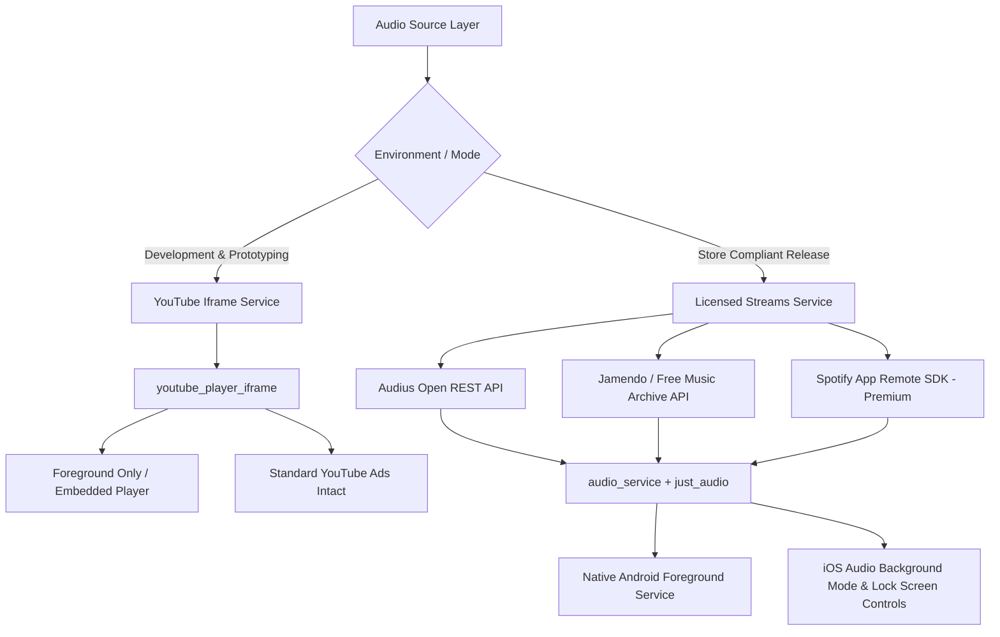
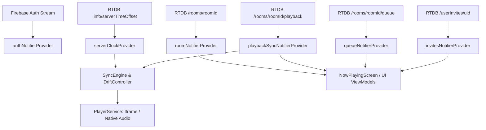

# CoListen: Synced Music Rooms — Complete Architecture, Implementation & UI/UX Specification

> **Project:** CoListen (formerly "Synced Music Rooms")  
> **Status:** Architecture & Implementation Blueprint  
> **Target Platforms:** iOS & Android (Flutter) + Firebase  
> **Reference Inputs:** [synced-music-rooms-project-idea.md](file:///c:/source/CoListen/synced-music-rooms-project-idea.md) & [PROJECT_STRUCTURE.md](file:///c:/source/CoListen/PROJECT_STRUCTURE.md)  
> **Document Author:** Senior Mobile Architect & UI/UX Systems Designer  

---

## Table of Contents

1. [Executive Summary & Gap Analysis](#1-executive-summary--gap-analysis)
2. [Audio Compliance & Source Strategy](#2-audio-compliance--source-strategy)
3. [System Architecture & Clean Directory Structure](#3-system-architecture--clean-directory-structure)
4. [Realtime Synchronization Engine & Math Model](#4-realtime-synchronization-engine--math-model)
5. [Environment Configuration & Secret Management (.env)](#5-environment-configuration--secret-management-env)
6. [Data Models, Cloud Functions & Security Rules](#6-data-models-cloud-functions--security-rules)
7. [Riverpod 2.x Reactive State Architecture](#7-riverpod-2x-reactive-state-architecture)
8. [Comprehensive UI/UX Design System & Screen Wireframes](#8-comprehensive-uiux-design-system--screen-wireframes)
9. [Edge Cases, Resilience & Error Recovery](#9-edge-cases-resilience--error-recovery)
10. [Step-by-Step Implementation Roadmap](#10-step-by-step-implementation-roadmap)

---

## 1. Executive Summary & Gap Analysis

### 1.1 Project Objective
**CoListen** is a real-time collaborative social listening application. Users create virtual private rooms where participants listen to the exact same audio in microsecond-grade synchronization, manage a shared collaborative queue, interact via real-time reactive emoji bursts, and enforce a strict role-based permission hierarchy (Host $\to$ DJ/Controller $\to$ Listener).

### 1.2 Cross-Document Analysis
By analyzing the foundational idea ([synced-music-rooms-project-idea.md](file:///c:/source/CoListen/synced-music-rooms-project-idea.md)) alongside the enterprise Flutter project standards ([PROJECT_STRUCTURE.md](file:///c:/source/CoListen/PROJECT_STRUCTURE.md)), several critical architectural requirements and gaps have been resolved:

| Requirement / Challenge | Document Idea Insight | Project Architecture Standard | Unified CoListen Solution |
| :--- | :--- | :--- | :--- |
| **Architectural Pattern** | Loosely defined feature folders | Enterprise Clean Architecture (Domain, Data, Presentation) | **Feature-First Clean Architecture** with Riverpod code generation and pure Dart domain entities. |
| **YouTube Ad/Background Terms** | Identified conflict (Req 4 & 5 violate YouTube TOS) | N/A | **Dual-Engine Player Abstraction Layer (`PlayerService`)**: Phase 1 prototype uses YouTube Iframe (foreground); Phase 2 production integrates Audius API & Jamendo for legal background audio. |
| **Sync Jitter & Latency** | Mentions 5s drift polling with 1.5s hard seek threshold | N/A | **Tri-Tier Sync Engine**: Combines Firebase RTDB Server Time Offset with silent drift tolerance ($<300$ms), smooth pitch-preserving micro-rate adjustments ($300\text{ms}-1200\text{ms}$), and hard seek ($>1200\text{ms}$). |
| **Queue Race Conditions** | Mentions admin client or Cloud Function advance | Repository & DataSource patterns | **Atomic Cloud Function Transaction (`advanceQueue`)** triggered idempotently with lease locks to prevent double-skips. |
| **UI/UX Foundations** | Basic 9-screen list | Core design tokens (app_theme, app_colors, widgets) | **Cyber-Acoustic Dark Design System**: Glassmorphism, dynamic blurred album canvases, reactive floating emoji springs, and tactile scrubbers. |

---

## 2. Audio Compliance & Source Strategy

### 2.1 The YouTube Compliance Dilemma
As identified in [synced-music-rooms-project-idea.md](file:///c:/source/CoListen/synced-music-rooms-project-idea.md), Requirements 4 (ad blocking) and 5 (background play) directly breach YouTube API Terms of Service (Sections 3.2.1 and 8.2) and will lead to immediate Google Play Store and Apple App Store rejections.



### 2.2 Swappable `PlayerService` Abstraction

```dart
// lib/features/playback/domain/services/player_service.dart
abstract class PlayerService {
  Future<void> initialize();
  Future<void> loadTrack({
    required String trackId,
    required AudioSourceType sourceType,
    Duration startPosition = Duration.zero,
    bool autoPlay = true,
  });
  Future<void> play();
  Future<void> pause();
  Future<void> seek(Duration position);
  Future<void> setPlaybackRate(double rate); // Used for smooth drift micro-adjustments
  Future<void> dispose();

  Stream<PlayerPlaybackState> get stateStream;
  Stream<Duration> get positionStream;
  Duration get currentPosition;
  bool get isBackgroundPlaySupported;
}

enum AudioSourceType {
  youtube,
  audius,
  jamendo,
  spotify,
}
```

---

## 3. System Architecture & Clean Directory Structure

Adopting the enterprise Clean Architecture standard from [PROJECT_STRUCTURE.md](file:///c:/source/CoListen/PROJECT_STRUCTURE.md) and tailoring it specifically for **CoListen**:

```text
colisten/
│
├── android/                             # Android native configuration (Foreground Service, WAKE_LOCK)
├── ios/                                 # iOS native configuration (UIBackgroundModes: audio)
│
├── assets/
│   ├── icons/                           # Custom SVG icons (play, pause, vinyl, dj_badge, listeners)
│   ├── animations/                      # Lottie animations (equalizer, confetti, soundwave)
│   └── images/                          # Branding & placeholders
│
├── lib/
│   ├── main.dart                        # Entry point, Firebase init, ProviderScope
│   ├── app.dart                         # MaterialApp, AppRouter, DarkTheme, Overlay Portal
│   │
│   ├── core/                            # Domain-agnostic infrastructure
│   │   ├── config/                      # AppConfig, Environment (dev, prod)
│   │   ├── constants/                   # FirebaseConstants, RouteConstants, UIConstants
│   │   ├── network/                     # Http client for YouTube Data & Audius APIs
│   │   ├── routing/                     # GoRouter with deep-link parser (/join/:code)
│   │   ├── storage/                     # SharedPreferences & FlutterSecureStorage
│   │   ├── sync/                        # Universal Sync Clock, drift algorithms
│   │   │   ├── server_clock.dart        # RTDB .info/serverTimeOffset calculator
│   │   │   └── drift_controller.dart    # Micro-rate and hard-seek sync manager
│   │   ├── theme/                       # Design tokens
│   │   │   ├── app_colors.dart          # Deep midnight, electric neon purple, cyan glow
│   │   │   ├── app_typography.dart      # Inter & Plus Jakarta Sans styling
│   │   │   └── app_dimens.dart          # Radii, paddings, glass elevations
│   │   └── widgets/                     # Generic design system components
│   │       ├── glass_container.dart     # Translucent blurred backdrop filter container
│   │       ├── animated_eq_bars.dart    # Dynamic audio visualizer bars
│   │       └── pulse_avatar.dart        # User avatar with pulsing status ring
│   │
│   ├── features/                        # Feature-First Architecture
│   │   │
│   │   ├── auth/                        # User onboarding & profile
│   │   │   ├── data/                    # AuthRepositoryImpl, FirebaseDataSource
│   │   │   ├── domain/                  # UserEntity, AuthState, AuthUseCase
│   │   │   └── presentation/            # LoginScreen, ProfileScreen, authProviders
│   │   │
│   │   ├── home/                        # Lobby & Quick Action Dashboard
│   │   │   ├── domain/                  # RecentRoomEntity, HomeDashboardState
│   │   │   └── presentation/            # HomeScreen, RecentRoomsList, ActiveInvitesBanner
│   │   │
│   │   ├── room/                        # Room Lifecycle, Presence & Permissions
│   │   │   ├── data/                    # RoomRepositoryImpl, PresenceRepositoryImpl
│   │   │   ├── domain/                  # RoomEntity, MemberEntity, Role (Host, DJ, Listener)
│   │   │   └── presentation/            # RoomScreen, CreateRoomSheet, JoinCodeSheet,
│   │   │                                # MembersBottomSheet, roomProviders
│   │   │
│   │   ├── playback/                    # Core Audio & Synchronization
│   │   │   ├── data/                    # PlaybackRepositoryImpl, PlayerService implementations:
│   │   │   │                            #  - youtube_iframe_player_service.dart
│   │   │   │                            #  - just_audio_player_service.dart
│   │   │   ├── domain/                  # PlaybackStateEntity, TrackEntity, PlayerService contract
│   │   │   └── presentation/            # NowPlayingView, VinylDiskWidget, WaveformProgressBar,
│   │   │                                # PlaybackControlsRow, playbackProviders
│   │   │
│   │   ├── queue/                       # Collaborative Music Queue
│   │   │   ├── data/                    # QueueRepositoryImpl, TrackSearchDataSource
│   │   │   ├── domain/                  # QueueItemEntity, FractionalOrderingHelper
│   │   │   └── presentation/            # QueueSheet, AddTrackSheet, SearchTrackView,
│   │   │                                # ReorderableQueueList, queueProviders
│   │   │
│   │   ├── reactions/                   # Live Emoji Floaters & Soundboard
│   │   │   ├── domain/                  # ReactionEntity, SoundboardItem
│   │   │   └── presentation/            # FloatingReactionCanvas, EmojiBar, reactionProviders
│   │   │
│   │   └── invites/                     # In-App Invites & OS Share Links (No FCM)
│   │       ├── data/                    # InviteRepositoryImpl (RTDB /userInvites listener)
│   │       ├── domain/                  # InviteEntity, DeepLinkHandler, ShareLinkService
│   │       └── presentation/            # InviteFriendsSheet, InAppInviteBannerWidget
│   │
│   └── shared/                          # Cross-feature shared models
│       ├── models/                      # Result<T>, AppException
│       └── extensions/                  # Context, Duration, String extensions
│
├── functions/                           # Firebase Cloud Functions (TypeScript v2)
│   ├── src/
│   │   ├── index.ts                     # Main entry
│   │   ├── createRoom.ts                # Code collision check & room setup (RTDB)
│   │   ├── joinRoom.ts                  # Rate-limited room joiner (RTDB)
│   │   ├── advanceQueue.ts              # Atomic RTDB transaction queue progression
│   │   └── cleanupRooms.ts              # Cron job garbage collection for stale rooms
│   └── package.json
│
├── database.rules.json                  # Production Realtime Database Security Rules
└── pubspec.yaml                         # Flutter dependencies
```

---

## 4. Realtime Synchronization Engine & Math Model

The synchronization engine is the core technical differentiator of CoListen. It solves the physical realities of mobile networks: **variable latency, jitter, and independent device clock drifts**.

### 4.1 Master Clock Offset Calibration
Clients never rely on the local phone clock (`DateTime.now()`). Instead, upon startup and room connection, the client computes the server time delta via Firebase Realtime Database:

$$\Delta_{\text{offset}} = t_{\text{server}} - t_{\text{local}} \quad (\text{from } \texttt{.info/serverTimeOffset})$$
$$t_{\text{current\_server}} = t_{\text{local}} + \Delta_{\text{offset}}$$

### 4.2 Expected Position Calculation
When a DJ pauses, seeks, or plays a track, a single atomic update is written to the Realtime Database at `/rooms/{roomId}/playback`:
- `positionMs`: Snapshot of track position at update moment.
- `updatedAt`: Server timestamp `{ ".sv": "timestamp" }`.
- `status`: `'playing'` | `'paused'` | `'buffering'`.

Any client calculating the expected playback position $P_{\text{expected}}$ at local moment $t$ evaluates:

$$P_{\text{expected}} = \begin{cases} 
\text{positionMs} + \left( t_{\text{current\_server}} - \text{updatedAt} \right), & \text{if } \text{status} = \text{'playing'} \\
\text{positionMs}, & \text{if } \text{status} \in \{\text{'paused'}, \text{'buffering'}\}
\end{cases}$$

### 4.3 Three-Tier Adaptive Drift Correction

Rather than harshly seeking the player on slight variations (which results in jarring audio stutters), CoListen utilizes an adaptive **Three-Tier Hysteresis Engine**:

```mermaid
flowchart TD
    A[Periodic Drift Check (every 3-5s)] --> B[Compute Drift: Δ = P_expected - P_actual]
    B --> C{Determine Drift Magnitude}
    
    C -->|< 300 ms| D[Tier 1: Silent Zone]
    D --> D1[No intervention. Imperceptible to ear. Smooth listening.]
    
    C -->|300 ms to 1200 ms| E[Tier 2: Pitch-Preserved Micro-Rate]
    E -->|If Δ > 0 (Falling behind)| E1[Set Playback Rate to 1.05x until synchronized]
    E -->|If Δ < 0 (Ahead of room)| E2[Set Playback Rate to 0.95x until synchronized]
    
    C -->|> 1200 ms| F[Tier 3: Hard Seek Fallback]
    F --> F1[Mute / Soft Fade-Out 80ms]
    F1 --> F2[Seek Player to P_expected]
    F2 --> F3[Unmute / Soft Fade-In 80ms]
```

---

## 5. Environment Configuration & Secret Management (.env)

Handling Firebase keys and third-party API credentials securely is a foundational requirement. Hardcoding credentials in source files (such as static `firebase_options.dart` or committing `google-services.json` and `GoogleService-Info.plist` to public or team Git repositories) exposes projects to quota hijacking and database abuse.

CoListen adopts an **Enforce .env Secrets Architecture** across the client and backend.

### 5.1 Environment Variable Matrix
All environment variables are declared in `.env` (derived from [`.env.example`](file:///c:/source/CoListen/.env.example)):

| Variable Key | Category | Target / Purpose |
| :--- | :--- | :--- |
| `APP_ENV` | App Core | `development`, `staging`, or `production` |
| `FIREBASE_PROJECT_ID` | Firebase Core | Identifies the Firebase project |
| `FIREBASE_STORAGE_BUCKET` | Firebase Core | Cloud Storage bucket URL |
| `FIREBASE_DATABASE_URL` | Firebase Core | Realtime Database URL for presence, queue, and playback sync |
| `FIREBASE_AUTH_DOMAIN` | Firebase Core | OAuth redirect domain |
| `FIREBASE_API_KEY_ANDROID` | Android Client | Web/Firebase API key restricted for Android SHA-1 |
| `FIREBASE_APP_ID_ANDROID` | Android Client | Android App ID (`1:123456:android:abcd...`) |
| `FIREBASE_API_KEY_IOS` | iOS Client | Web/Firebase API key restricted for iOS Bundle ID |
| `FIREBASE_APP_ID_IOS` | iOS Client | iOS App ID (`1:123456:ios:abcd...`) |
| `FIREBASE_IOS_CLIENT_ID` | iOS Client | Google OAuth Client ID for Apple platform |
| `FIREBASE_IOS_BUNDLE_ID` | iOS Client | Bundle identifier (`com.colisten.app`) |
| `FIREBASE_API_KEY_WEB` | Web / Debug | API key for local web debug tools |
| `FIREBASE_APP_ID_WEB` | Web / Debug | App ID for local web preview |
| `YOUTUBE_DATA_API_KEY` | Music Services | Google Cloud API key for track search and metadata |
| `AUDIUS_APP_NAME` | Music Services | Application identifier for Audius Web3 streaming |
| `AUDIUS_API_KEY` | Music Services | Optional access key for Audius API |

---

### 5.2 Dynamic Client-Side Firebase Options Factory
Instead of running `flutterfire configure` to generate hardcoded credentials, CoListen dynamically reads from `.env` and constructs `FirebaseOptions` at application bootstrap:

```dart
// lib/core/config/env_config.dart
import 'package:flutter_dotenv/flutter_dotenv.dart';

class EnvConfig {
  static Future<void> init() async {
    await dotenv.load(fileName: ".env");
  }

  static String get(String key, {String fallback = ''}) {
    return dotenv.env[key] ?? String.fromEnvironment(key, defaultValue: fallback);
  }

  // Firebase Core (Single Realtime Database Architecture)
  static String get firebaseProjectId => get('FIREBASE_PROJECT_ID');
  static String get firebaseStorageBucket => get('FIREBASE_STORAGE_BUCKET');
  static String get firebaseDatabaseUrl => get('FIREBASE_DATABASE_URL');
  static String get firebaseAuthDomain => get('FIREBASE_AUTH_DOMAIN');

  // Platform API Keys
  static String get firebaseApiKeyAndroid => get('FIREBASE_API_KEY_ANDROID');
  static String get firebaseAppIdAndroid => get('FIREBASE_APP_ID_ANDROID');
  static String get firebaseApiKeyIos => get('FIREBASE_API_KEY_IOS');
  static String get firebaseAppIdIos => get('FIREBASE_APP_ID_IOS');
  static String get firebaseIosClientId => get('FIREBASE_IOS_CLIENT_ID');
  static String get firebaseIosBundleId => get('FIREBASE_IOS_BUNDLE_ID');

  // External APIs
  static String get youtubeApiKey => get('YOUTUBE_DATA_API_KEY');
  static String get audiusAppName => get('AUDIUS_APP_NAME', fallback: 'CoListen');
}
```

```dart
// lib/core/config/firebase_options_factory.dart
import 'dart:io' show Platform;
import 'package:firebase_core/firebase_core.dart';
import 'package:flutter/foundation.dart';
import 'env_config.dart';

class FirebaseOptionsFactory {
  static FirebaseOptions get currentPlatformOptions {
    if (kIsWeb) {
      return FirebaseOptions(
        apiKey: EnvConfig.get('FIREBASE_API_KEY_WEB'),
        appId: EnvConfig.get('FIREBASE_APP_ID_WEB'),
        messagingSenderId: '', // No Cloud Messaging required
        projectId: EnvConfig.firebaseProjectId,
        authDomain: EnvConfig.firebaseAuthDomain,
        databaseURL: EnvConfig.firebaseDatabaseUrl,
        storageBucket: EnvConfig.firebaseStorageBucket,
      );
    }

    if (Platform.isAndroid) {
      return FirebaseOptions(
        apiKey: EnvConfig.firebaseApiKeyAndroid,
        appId: EnvConfig.firebaseAppIdAndroid,
        messagingSenderId: '', // No Cloud Messaging required
        projectId: EnvConfig.firebaseProjectId,
        databaseURL: EnvConfig.firebaseDatabaseUrl,
        storageBucket: EnvConfig.firebaseStorageBucket,
      );
    } else if (Platform.isIOS || Platform.isMacOS) {
      return FirebaseOptions(
        apiKey: EnvConfig.firebaseApiKeyIos,
        appId: EnvConfig.firebaseAppIdIos,
        messagingSenderId: '', // No Cloud Messaging required
        projectId: EnvConfig.firebaseProjectId,
        databaseURL: EnvConfig.firebaseDatabaseUrl,
        storageBucket: EnvConfig.firebaseStorageBucket,
        iosClientId: EnvConfig.firebaseIosClientId,
        iosBundleId: EnvConfig.firebaseIosBundleId,
      );
    }

    throw UnsupportedError('Unsupported platform for Firebase initialization');
  }
}

    throw UnsupportedError('Unsupported platform for Firebase initialization');
  }
}
```

```dart
// lib/main.dart (Bootstrap)
import 'package:flutter/material.dart';
import 'package:flutter_riverpod/flutter_riverpod.dart';
import 'package:firebase_core/firebase_core.dart';
import 'core/config/env_config.dart';
import 'core/config/firebase_options_factory.dart';
import 'app.dart';

Future<void> main() async {
  WidgetsFlutterBinding.ensureInitialized();
  
  // 1. Load secrets from .env
  await EnvConfig.init();
  
  // 2. Initialize Firebase using dynamic options factory
  await Firebase.initializeApp(
    options: FirebaseOptionsFactory.currentPlatformOptions,
  );

  runApp(const ProviderScope(child: CoListenApp()));
}
```

---

### 5.3 Backend & Cloud Functions Secrets Management
For Firebase Cloud Functions (TypeScript), sensitive variables such as server tokens or third-party webhooks are never hardcoded:

1. **Local Development:** Handled in `functions/.env.local`.
2. **Production Deployment:** Managed via Google Cloud Secret Manager integrated with Firebase Functions v2:

```typescript
// functions/src/config.ts
import { defineSecret, defineString } from 'firebase-functions/params';

export const youtubeApiKey = defineSecret('YOUTUBE_DATA_API_KEY');
export const environment = defineString('APP_ENV', { default: 'development' });
```

---

### 5.4 Compilation & CI/CD Secret Injection
Developers have two seamless ways to run the app with `.env`:

1. **Standard `.env` file loading:** `flutter_dotenv` reads `.env` asset directly at runtime.
2. **Native Build-Time Injection:**
   ```bash
   flutter run --dart-define-from-file=.env
   flutter build apk --dart-define-from-file=.env --release
   flutter build ipa --dart-define-from-file=.env --release
   ```
3. **CI/CD Pipeline (GitHub Actions):** The `.env` file is generated on the fly in the runner from GitHub Actions Repository Secrets before compiling, ensuring zero secrets persist in source control.

---

## 6. Single Realtime Database Architecture, Models & Security Rules

To maximize sync responsiveness and eliminate architectural bloat, **CoListen uses Firebase Realtime Database (RTDB) as its single, unified database**, eliminating Cloud Firestore and Cloud Messaging entirely:

- **Sub-30ms Persistent WebSocket:** Unlike document-polled snapshots, RTDB holds an open bi-directional WebSocket connection. When a DJ hits pause, play, or seek, listeners receive the event in under 30ms, yielding imperceptible sync lag.
- **Unified Presence & Server Time:** Native `.info/serverTimeOffset` and `onDisconnect()` live under the exact same database client without cross-service sync issues.
- **Zero Push Notification Overhead:** In-app invites are handled via reactive RTDB listeners on `/userInvites/{uid}`, and external room sharing uses native OS share sheets (WhatsApp, Messages, etc.) and Universal Links (`https://colisten.app/join/:code`).
- **Atomic Transactions:** Realtime Database `ref.transaction()` provides atomic operations for room code generation, rate-limited room joins, and double-skip prevention during queue advancement.

### 6.1 Complete Realtime Database JSON Tree
All application data lives in a normalized, high-performance JSON hierarchy:

```json
{
  "users": {
    "user_abc123": {
      "displayName": "Alex",
      "photoUrl": "https://...",
      "createdAt": 1795500000000
    }
  },
  "roomCodes": {
    "K7P2QX": "room_xyz987"
  },
  "presence": {
    "room_xyz987": {
      "user_abc123": {
        "online": true,
        "lastSeen": 1795500000000,
        "clientState": "playing"
      }
    }
  },
  "userInvites": {
    "user_def456": {
      "invite_1": {
        "fromUid": "user_abc123",
        "fromName": "Alex",
        "roomId": "room_xyz987",
        "roomName": "Late Night Lo-Fi Beats",
        "roomCode": "K7P2QX",
        "status": "pending",
        "createdAt": 1795500000000
      }
    }
  },
  "rooms": {
    "room_xyz987": {
      "code": "K7P2QX",
      "name": "Late Night Lo-Fi Beats",
      "adminId": "user_abc123",
      "createdAt": 1795500000000,
      "isActive": true,
      "settings": {
        "membersCanAddSongs": true,
        "membersCanVoteSkip": true,
        "voteSkipThresholdPercent": 50,
        "isPrivate": false
      },
      "members": {
        "user_abc123": {
          "displayName": "Alex",
          "isController": true,
          "joinedAt": 1795500000000
        },
        "user_def456": {
          "displayName": "Sarah",
          "isController": false,
          "joinedAt": 1795500005000
        }
      },
      "playback": {
        "currentItemId": "queue_item_99",
        "trackId": "jfKfPfyJRdk",
        "sourceType": "youtube",
        "title": "Lofi Hip Hop Radio - Beats to Relax/Study to",
        "artist": "Lofi Girl",
        "thumbnailUrl": "https://i.ytimg.com/vi/jfKfPfyJRdk/hqdefault.jpg",
        "durationMs": 0,
        "status": "playing",
        "positionMs": 142300,
        "updatedAt": 1795500020000,
        "updatedBy": "user_abc123"
      },
      "queue": {
        "item_1": {
          "trackId": "5qap5aO4i9A",
          "sourceType": "youtube",
          "title": "Lofi Beats for Coding",
          "artist": "ChilledCow",
          "thumbnailUrl": "https://i.ytimg.com/vi/5qap5aO4i9A/hqdefault.jpg",
          "durationMs": 184000,
          "addedBy": "user_def456",
          "addedByName": "Sarah K.",
          "addedAt": 1795500030000,
          "order": 1.5,
          "voteSkipUids": {
            "user_def456": true
          }
        }
      },
      "reactions": {
        "reaction_1": {
          "uid": "user_def456",
          "displayName": "Sarah",
          "emoji": "🔥",
          "createdAt": 1795500045000
        }
      }
    }
  }
}
```

> **Lexorank Fractional Ordering in RTDB:** When inserting a track between items with orders `1.0` and `2.0`, the new item is assigned `order = (1.0 + 2.0) / 2 = 1.5`. Querying `/rooms/{roomId}/queue` ordered by `.orderByChild('order')` returns items in accurate playback sequence without modifying other elements.

---

### 6.2 Production Realtime Database Security Rules (`database.rules.json`)
The standalone [`database.rules.json`](file:///c:/source/CoListen/database.rules.json) file protects every path in the database:

```json
{
  "rules": {
    ".read": false,
    ".write": false,

    "users": {
      "$uid": {
        ".read": "auth != null",
        ".write": "auth != null && auth.uid === $uid"
      }
    },

    "roomCodes": {
      "$code": {
        ".read": "auth != null",
        ".write": "auth != null && (!data.exists() || !newData.exists())"
      }
    },

    "presence": {
      "$roomId": {
        ".read": "auth != null && root.child('rooms/' + $roomId + '/members/' + auth.uid).exists()",
        "$uid": {
          ".write": "auth != null && auth.uid === $uid"
        }
      }
    },

    "userInvites": {
      "$toUid": {
        ".read": "auth != null && auth.uid === $toUid",
        "$inviteId": {
          ".write": "auth != null && (auth.uid === $toUid || auth.uid === newData.child('fromUid').val())"
        }
      }
    },

    "rooms": {
      "$roomId": {
        ".read": "auth != null && data.child('members/' + auth.uid).exists()",
        ".write": "auth != null && (!data.exists() || data.child('adminId').val() === auth.uid)",

        "members": {
          "$uid": {
            ".write": "auth != null && (auth.uid === $uid || data.parent().parent().child('adminId').val() === auth.uid || newData.parent().parent().child('adminId').val() === auth.uid)"
          }
        },

        "playback": {
          ".write": "auth != null && (data.parent().child('adminId').val() === auth.uid || data.parent().child('members/' + auth.uid + '/isController').val() === true)"
        },

        "queue": {
          "$itemId": {
            ".write": "auth != null && (data.parent().parent().child('adminId').val() === auth.uid || data.parent().parent().child('members/' + auth.uid + '/isController').val() === true || (data.parent().parent().child('settings/membersCanAddSongs').val() === true && !data.exists()) || (data.child('addedBy').val() === auth.uid))"
          }
        },

        "reactions": {
          "$reactionId": {
            ".write": "auth != null && root.child('rooms/' + $roomId + '/members/' + auth.uid).exists()"
          }
        }
      }
    }
  }
}
```

---

### 6.3 Realtime Database Cloud Functions (TypeScript v2)

1. **`createRoom` (Callable):**
   - Generates an unambiguous 6-character room code using charset `23456789ABCDEFGHJKLMNPQRSTUVWXYZ` (excludes `0, O, 1, I`).
   - Uses `admin.database().ref().update()` to multi-path atomically create `roomCodes/${code}` and `rooms/${roomId}` in a single round-trip.
2. **`joinRoom` (Callable):**
   - Rate-limits attempts per UID (maximum 5 attempts/minute) to stop room code brute-forcing.
   - Looks up `roomCodes/${code}` $\to$ adds user into `rooms/${roomId}/members/${uid}`.
3. **`advanceQueue` (Callable / Triggered):**
   - When the current track ends, the client invokes `advanceQueue(roomId)`.
   - Executes `roomRef.transaction()`: reads the queue, finds the item with the minimum `order`, sets it into `playback`, removes it from `queue`, and resets `positionMs: 0` and `updatedAt: ServerValue.TIMESTAMP`.
   - If the queue is empty, sets `status: 'paused'`, keeping the last track thumbnail as static resting artwork.

---

## 7. Riverpod 2.x Reactive State Architecture



### 6.1 Playback Sync Controller Implementation

```dart
// lib/features/playback/presentation/providers/playback_sync_provider.dart
import 'dart:async';
import 'package:flutter_riverpod/flutter_riverpod.dart';
import '../../domain/services/player_service.dart';
import '../../domain/entities/playback_state_entity.dart';
import '../../../../core/sync/server_clock.dart';

final playbackSyncNotifierProvider = StateNotifierProvider.family<
    PlaybackSyncNotifier, AsyncValue<PlaybackStateEntity>, String>(
  (ref, roomId) {
    final playerService = ref.watch(playerServiceProvider);
    final serverClock = ref.watch(serverClockProvider);
    final repository = ref.watch(playbackRepositoryProvider);
    return PlaybackSyncNotifier(roomId, playerService, serverClock, repository);
  },
);

class PlaybackSyncNotifier extends StateNotifier<AsyncValue<PlaybackStateEntity>> {
  final String roomId;
  final PlayerService _player;
  final ServerClock _clock;
  final PlaybackRepository _repo;

  StreamSubscription? _remoteSub;
  Timer? _driftTimer;

  PlaybackSyncNotifier(this.roomId, this._player, this._clock, this._repo)
      : super(const AsyncValue.loading()) {
    _listenToRemotePlayback();
    _startDriftMonitoring();
  }

  void _listenToRemotePlayback() {
    _remoteSub = _repo.watchPlaybackState(roomId).listen((remoteState) async {
      state = AsyncValue.data(remoteState);
      await _applyRemoteState(remoteState);
    });
  }

  Future<void> _applyRemoteState(PlaybackStateEntity remote) async {
    final serverNow = _clock.currentServerTime;
    final elapsedMs = remote.status == 'playing'
        ? serverNow.difference(remote.updatedAt).inMilliseconds
        : 0;
    final targetPosition = Duration(milliseconds: remote.positionMs + elapsedMs);

    // If track changed, load new track
    if (_player.currentTrackId != remote.trackId) {
      await _player.loadTrack(
        trackId: remote.trackId,
        sourceType: remote.sourceType,
        startPosition: targetPosition,
        autoPlay: remote.status == 'playing',
      );
      return;
    }

    // Otherwise align play/pause
    if (remote.status == 'playing') {
      await _player.play();
    } else {
      await _player.pause();
    }
  }

  void _startDriftMonitoring() {
    _driftTimer = Timer.periodic(const Duration(seconds: 4), (_) async {
      final current = state.valueOrNull;
      if (current == null || current.status != 'playing') return;

      final serverNow = _clock.currentServerTime;
      final expectedMs = current.positionMs +
          serverNow.difference(current.updatedAt).inMilliseconds;
      final actualMs = _player.currentPosition.inMilliseconds;
      final drift = expectedMs - actualMs;

      // Tier 1: Drift < 300ms -> Ignore
      if (drift.abs() < 300) {
        await _player.setPlaybackRate(1.0);
      }
      // Tier 2: 300ms <= Drift <= 1200ms -> Micro-rate adjust (pitch-preserved)
      else if (drift.abs() <= 1200) {
        final rate = drift > 0 ? 1.05 : 0.95;
        await _player.setPlaybackRate(rate);
      }
      // Tier 3: Drift > 1200ms -> Hard seek
      else {
        await _player.seek(Duration(milliseconds: expectedMs));
        await _player.setPlaybackRate(1.0);
      }
    });
  }

  @override
  void dispose() {
    _remoteSub?.cancel();
    _driftTimer?.cancel();
    super.dispose();
  }
}
```

---

## 8. Comprehensive UI/UX Design System & Screen Wireframes

### 7.1 Visual Identity & Design Tokens

```
=============================================================================
                  COLISTEN COLOR TOKENS & ELEVATIONS
=============================================================================
Background Base   : #0B0C10  (Absolute Pitch Black/Navy)
Surface Elevated  : #16181F  (Cards, Bottom Sheets)
Surface Highlight : #232736  (Pills, Active Input Fields)
Primary Accent    : #7C3AED  (Electric Neon Violet - Brand Identity)
Secondary Accent  : #06B6D4  (Cyan Glow - Active Sync Indicator)
Live Pulse Red    : #F43F5E  (Recording/Broadcasting & Hot Reactions)
Text Primary      : #F8FAFC  (High Contrast Pure White)
Text Muted        : #94A3B8  (Subtitles, Timestamps, Inactive Toggles)
Glass Overlay     : rgba(22, 24, 31, 0.75) with 24px Backdrop Blur
Corner Radii      : Cards: 20px | Buttons: 14px | Pills: 999px (Capsule)
=============================================================================
```

---

### 7.2 Complete Screen Wireframes & UI Specifications

#### Screen 1: Splash & Quick Onboarding (`/auth`)
*Clean, modern, friction-free login with zero barriers to entry.*

```
+--------------------------------------------------------+
|                                                        |
|                      [  ((●))  ]                       |
|                       CoListen                         |
|             "Hear what your friends hear."             |
|                                                        |
|     +--------------------------------------------+     |
|     |   [G] Continue with Google                 |     |
|     +--------------------------------------------+     |
|     |   [] Continue with Apple                  |     |
|     +--------------------------------------------+     |
|                                                        |
|                      -- or --                          |
|                                                        |
|     +--------------------------------------------+     |
|     |   [👤] Quick Guest Mode (Set Handle)       |     |
|     +--------------------------------------------+     |
|                                                        |
+--------------------------------------------------------+
```

---

#### Screen 2: Home Dashboard & Lobby (`/home`)
*Instant access to active listening rooms, pending invites, and recent history.*

```
+--------------------------------------------------------+
|  CoListen                      [🔔 2]   [Avatar (Me)]  |
+--------------------------------------------------------+
|                                                        |
|  [!] INVITE: Sarah K. invited you to "Study Session"   |
|      [ Accept & Join ]        [ Dismiss ]              |
|                                                        |
|  QUICK ACTIONS                                         |
|  +-----------------------+   +-----------------------+ |
|  |  [ + ] Create Room    |   |  [ # ] Enter Code     | |
|  |  Be the host & DJ     |   |  Join friends         | |
|  +-----------------------+   +-----------------------+ |
|                                                        |
|  ACTIVE ROOMS WITH FRIENDS                             |
|  +---------------------------------------------------+ |
|  | ((●)) Late Night Vibes            [ 4 Listening ] | |
|  | Host: Alex  •  Track: Starboy                     | |
|  | [Avatar 1][Avatar 2][Avatar 3]        [ Join -> ] | |
|  +---------------------------------------------------+ |
|                                                        |
|  RECENT ROOMS                                          |
|  • Lo-Fi Chillroom (Yesterday)                         |
|  • Roadtrip Playlist (3 days ago)                      |
|                                                        |
+--------------------------------------------------------+
```

---

#### Screen 3: Join Room by Code Modal (`/join`)
*Single-focus, high-ergonomics 6-character code screen with auto-clipboard detection.*

```
+--------------------------------------------------------+
|  [X] Close                                             |
|                                                        |
|                     Enter Room Code                    |
|             Type the 6-character room code            |
|                                                        |
|            +---+ +---+ +---+   +---+ +---+ +---+       |
|            | K | | 7 | | P | - | 2 | | Q | | X |       |
|            +---+ +---+ +---+   +---+ +---+ +---+       |
|                                                        |
|            [ 📋 Paste from Clipboard (K7P2QX) ]        |
|                                                        |
|     +--------------------------------------------+     |
|     |            [  JOIN ROOM NOW  ]             |     |
|     +--------------------------------------------+     |
|                                                        |
|                1     2     3                           |
|                4     5     6                           |
|                7     8     9                           |
|                      0     [<]                         |
+--------------------------------------------------------+
```

---

#### Screen 4: The Master Room Experience (`/room/:id`)
*The crown jewel screen: features dynamic background blur, rotating album vinyl, synched lyrics/scrubber, reactive emoji bursts, and controller action bar.*

```
+--------------------------------------------------------+
| [<] Leave   Room: K7P2QX [📋]     ((●)) 5 Online   [⚙️] |
+--------------------------------------------------------+
|                                                        |
|                 [ DYNAMIC BLURRED ARTWORK ]            |
|                                                        |
|                     .----------------.                 |
|                    /    .--------.    \                |
|                   |    /   (●)    \    |   [Vinyl Ring]|
|                   |   |  ALBUM ART |   |   (Rotates    |
|                   |    \          /    |    when play) |
|                    \    '--------'    /                |
|                     '----------------'                 |
|                                                        |
|    Midnight City                                       |
|    M83  •  Hurry Up, We're Dreaming   [YouTube Source] |
|                                                        |
|    01:24 ==================O----------------- 04:03    |
|    [🔊 Live Synced with Host]                          |
|                                                        |
|    [🤍 Fav]   [ |<< ]   [  || Pause  ]   [ >>| ]   [🔀]|
|    *(Note: Listeners see Play/Pause disabled with lock)*|
|                                                        |
|  ================ LIVE REACTIONS ===================== |
|  [ 🔥 12 ]   [ ❤️ 8 ]   [ 💃 15 ]   [ 🎧 4 ]   [ + React]|
|  *(Tapping launches floating animated particles upward)*|
|                                                        |
|  +---------------------------------------------------+ |
|  | UP NEXT (3) : Daft Punk - One More Time           | |
|  | [ ^ Swipe Up for Queue & Members ]                 | |
|  +---------------------------------------------------+ |
+--------------------------------------------------------+
```

---

#### Screen 5: Real-Time Collaborative Queue Sheet
*Reorderable drag-and-drop queue for DJs with instant multi-source search.*

```
+--------------------------------------------------------+
|                       === [Drag Bar] ===               |
|  Shared Queue (4 tracks)             [ + Add Song ]    |
+--------------------------------------------------------+
|  NOW PLAYING                                           |
|  [|||] Midnight City - M83                    04:03    |
|        Added by Alex (Host)                            |
|                                                        |
|  UP NEXT                                               |
|  1. [=] One More Time - Daft Punk             05:20  [X|
|         Added by Sarah K.                              |
|                                                        |
|  2. [=] The Less I Know The Better - Tame Impala 03:36[|
|         Added by You • 2 votes to skip [Skip🗳️]        |
|                                                        |
|  3. [=] After Hours - The Weeknd              06:01  [X|
|         Added by Michael                               |
|                                                        |
|  *(Hold & drag [=] icon to reorder fractional index)*  |
+--------------------------------------------------------+
```

---

#### Screen 6: Add Song Search & Preview Modal
*Unified search across YouTube and Audius with instant URL paste detection.*

```
+--------------------------------------------------------+
|  [X] Cancel                     Add Song to Queue      |
+--------------------------------------------------------+
|  [ 🔍 Search title, artist or paste YouTube URL...  ]  |
|                                                        |
|  SEARCH RESULTS                                        |
|  +---------------------------------------------------+ |
|  | [Thumb] Starboy                                   | |
|  |         The Weeknd  •  03:50  •  YouTube          | |
|  |         [ + Add to Queue ]     [ ▶ Preview ]      | |
|  +---------------------------------------------------+ |
|  | [Thumb] Blinding Lights                           | |
|  |         The Weeknd  •  03:20  •  Audius (Free)    | |
|  |         [ + Add to Queue ]     [ ▶ Preview ]      | |
|  +---------------------------------------------------+ |
|                                                        |
|  [!] Paste any valid link: https://youtu.be/...        |
+--------------------------------------------------------+
```

---

#### Screen 7: Room Members & Permissions Sheet
*Admin controls: 1-tap DJ promotion, kick member, and live buffering monitor.*

```
+--------------------------------------------------------+
|  Room Members (5)                     Code: K7P2QX     |
+--------------------------------------------------------+
|  👑 Alex (You)               [ Host / Admin ]          |
|     Listening • 0ms drift                              |
|                                                        |
|  🎛️ Sarah K.                 [ Controller / DJ ] [ Revoke ]
|     Listening • 20ms drift                             |
|                                                        |
|  🎧 David M.                 [ Listener ]         [ Make DJ ]
|     Listening • Buffering...                           |
|     [ Remove from Room ]                               |
|                                                        |
|  🎧 Elena R.                 [ Listener ]         [ Make DJ ]
|     Listening • In Sync                                |
|                                                        |
|  ROOM CONTROLS (Host Only)                             |
|  [X] Allow all members to add songs                    |
|  [ ] Vote-to-skip enabled (50% consensus)              |
|  [ Transfer Room Host ]                                |
|  [ End Room for Everyone ]                             |
+--------------------------------------------------------+
```

---

## 9. Edge Cases, Resilience & Error Recovery

### 8.1 YouTube Video Embedding Disabled
- **Problem:** Certain copyrighted music videos on YouTube have `embedded: false` flags in their syndication policy, returning error code `150` or `101`.
- **Solution:** The `YoutubeIframePlayerService` intercepts error code `101`/`150`. If caller is the Host, it automatically posts an informative Toast (`"Track cannot be embedded. Auto-skipping to next..."`) and triggers `advanceQueue()` atomically.

### 8.2 Mobile Webview Autoplay Policy
- **Problem:** WebKit and Android WebView block programmatic audio `.play()` calls if the user has not physically tapped the screen yet.
- **Solution:** When a new user joins a room that is already in `playing` status, show a stylish floating glass badge: `[ Tap to Sync Sound 🎧 ]`. Once tapped, audio unlocks permanently for that session.

### 8.3 Host Disconnection & Graceful Failover
- **Problem:** If the room Host closes the app, what happens to the room?
- **Solution:** 
  1. Realtime Database presence detects Host `offline` via `onDisconnect()`.
  2. A 90-second grace timer begins.
  3. If Host doesn't reconnect, the system automatically promotes the longest-standing active Controller (or senior Listener) to `adminId`.
  4. If all members disconnect, a scheduled Cloud Function marks `isActive: false` and archives the room.

---

## 10. Step-by-Step Implementation Roadmap

```mermaid
gantt
    title CoListen Engineering Roadmap
    dateFormat  YYYY-MM-DD
    section Foundation
    Phase 1: Project Setup & Clean Architecture     :done,    des1, 2026-11-25, 3d
    Phase 2: Auth, Presence & Room Codes            :active,  des2, 2026-11-28, 4d
    section Audio Core
    Phase 3: Player Layer & YouTube Engine          :         des3, 2026-12-02, 5d
    Phase 4: Sync Engine & Drift Correction         :         des4, 2026-12-07, 5d
    section Collaborative Features
    Phase 5: Queue, Reordering & Cloud Functions    :         des5, 2026-12-12, 4d
    Phase 6: UI Polish, Floating Reactions & Stores :         des6, 2026-12-16, 5d
```

### Phase 1: Project Scaffolding & Core Architecture (Days 1–3)
- Initialize Flutter 3.x project with package name `com.colisten.app`.
- Set up Feature-First directory hierarchy according to Section 3.
- Configure `app_colors.dart`, `app_typography.dart`, and base glassmorphic UI components.
- Setup Riverpod 2.5 with code generation (`riverpod_generator`).

### Phase 2: Firebase, Auth & Presence (Days 4–7)
- Integrate Firebase Auth (Google Sign-In + Anonymous Guest mode).
- Implement Cloud Function `createRoom` with collision-free 6-char code generator.
- Implement Cloud Function `joinRoom` with rate limiting.
- Bind Realtime Database `.info/connected` and `/presence/{roomId}/{uid}` heartbeat.

### Phase 3: Player Abstraction & YouTube Service (Days 8–12)
- Implement `PlayerService` domain contract.
- Build `YoutubeIframePlayerService` with `youtube_player_iframe`.
- Add track metadata scraper and search integration using YouTube Data API v3 (with 24h memory caching to preserve quota).
- Build the initial Now Playing UI with album art, rotating vinyl, and title/artist typography.

### Phase 4: Master Sync Engine & Drift Calibration (Days 13–17)
- Implement `ServerClock` utilizing Firebase RTDB `.info/serverTimeOffset`.
- Wire `playbackSyncNotifierProvider` to listen to Realtime Database `/rooms/{roomId}/playback`.
- Implement the 3-Tier Drift Correction algorithm (silent $<300$ms, micro-rate $300-1200$ms, hard seek $>1200$ms).
- Validate synchronization across 2 physical phones and an emulator on 3G simulated network throttling.

### Phase 5: Collaborative Queue & Cloud Function Automations (Days 18–21)
- Build `ReorderableListView` with fractional ordering arithmetic (`order = (prev + next) / 2`).
- Build `AddSongSheet` with search & YouTube URL paste parsing.
- Deploy Cloud Function `advanceQueue` with atomic transaction locking.
- Deploy `database.rules.json` to Firebase Realtime Database.

### Phase 6: Live Reactions, Permissions & Store Readiness (Days 22–26)
- Build `FloatingReactionCanvas` with hardware-accelerated spring animations.
- Implement Members & Permissions management sheet for Host.
- Configure `app_links` for Universal Deep Linking (`https://colisten.app/join/:code`).
- Prepare Phase 2 licensed audio provider (`just_audio` + `audio_service`) for store compliance.

---

*This document serves as the complete, authoritative engineering and design specification for CoListen. All modules are designed for zero-debt modularity and immediate implementation.*
