# CoListen: Revised Project Execution Plan

> **Project:** CoListen (Synchronized Social Music Rooms)  
> **Status:** Architecture Approved & Environment Configured  
> **Target Platforms:** iOS & Android (Flutter) + Firebase  
> **Firebase Project:** `colisten-5f458` (Realtime Database Only)  
> **Date:** November 2026  

---

## 1. Project Overview & Current Workspace State

CoListen is a real-time collaborative social listening app where users listen to music simultaneously in private rooms, manage a shared queue with role-based permissions, and react in real-time with floating emoji streams.

### 1.1 Root Files & Their Role in the Project

| File | Purpose & Status |
| :--- | :--- |
| [`.env`](file:///c:/source/CoListen/.env) | **ACTIVE & CONFIGURED:** Contains verified credentials for Firebase project `colisten-5f458`, RTDB URL `https://colisten-5f458-default-rtdb.firebaseio.com`, Android App ID, iOS App ID, and client IDs. |
| [`.env.example`](file:///c:/source/CoListen/.env.example) | **TEMPLATE:** Clean repository template for new developers. |
| [`.gitignore`](file:///c:/source/CoListen/.gitignore) | **SECURITY ENFORCED:** Strictly prevents `.env`, `google-services.json`, `GoogleService-Info.plist`, and signing certificates from reaching Git. |
| [`database.rules.json`](file:///c:/source/CoListen/database.rules.json) | **SECURITY RULES:** Production Realtime Database security rules enforcing role hierarchies (`adminId`, `isController`, `membersCanAddSongs`). |
| [`COLISTEN_IMPLEMENTATION_AND_UI_SPEC.md`](file:///c:/source/CoListen/COLISTEN_IMPLEMENTATION_AND_UI_SPEC.md) | **TECHNICAL SPECIFICATION:** 10-section technical and UI/UX blueprint detailing math models, wireframes, and Riverpod state management. |
| [`PROJECT_STRUCTURE.md`](file:///c:/source/CoListen/PROJECT_STRUCTURE.md) | **ARCHITECTURE GUIDE:** Reference template defining Feature-First Clean Architecture conventions. |
| [`synced-music-rooms-project-idea.md`](file:///c:/source/CoListen/synced-music-rooms-project-idea.md) | **FOUNDATION:** Original requirements, compliance boundaries, and permission models. |

---

## 2. Refined Architecture Highlights

Based on your design choices, the architecture has been streamlined into a **high-performance, low-complexity model**:

```mermaid
graph TD
    subgraph "Backend: Firebase (Project colisten-5f458)"
        RTDB["Single Realtime Database (RTDB)"]
        AUTH["Firebase Authentication (Google + Anonymous Guest)"]
        CF["Cloud Functions v2 (TypeScript - Atomic Transactions)"]
    end
    
    subgraph "Realtime Database Schema"
        R1["/rooms/{roomId} (Settings, Members, Roles)"]
        R2["/rooms/{roomId}/playback (Atomic State: positionMs, status, updatedAt)"]
        R3["/rooms/{roomId}/queue (Lexorank Fractional Order)"]
        R4["/rooms/{roomId}/reactions (Live Emoji Bursts)"]
        R5["/presence/{roomId}/{uid} (Native onDisconnect Heartbeat)"]
        R6["/userInvites/{uid} (Reactive In-App Invites)"]
        R7[".info/serverTimeOffset (Sub-30ms Master Clock Delta)"]
    end
    
    subgraph "Flutter Client (com.colisten.app)"
        C1["EnvConfig & FirebaseOptionsFactory (Zero-Leakage .env Bootstrapper)"]
        C2["Riverpod 2.5 State Management (Clean Feature-First)"]
        C3["Tri-Tier Audio Sync Engine (Micro-rate 0.95x-1.05x + Hard Seek)"]
        C4["Pluggable PlayerService (YouTube Iframe Foreground + Audius Background)"]
        C5["Cyber-Acoustic Dark UI (Glassmorphic, Rotating Vinyl, Floating Reactions)"]
        C6["Native OS Share Sheet (WhatsApp / SMS / Universal Link /join/:code)"]
    end
    
    RTDB --- R1 & R2 & R3 & R4 & R5 & R6 & R7
    AUTH & RTDB & CF <==> C1 & C2
```



### Key Architectural Decisions
1. **Single Database (RTDB Only):**
   - No Cloud Firestore. Everything runs through Firebase Realtime Database over persistent WebSockets ($<30$ms latency).
2. **Zero Cloud Messaging (No FCM / APNs):**
   - In-app invites reactively trigger through Realtime Database listeners on `/userInvites/{uid}`.
   - Out-of-app sharing uses the native OS Share Sheet (WhatsApp, Telegram, SMS) and Universal Deep Links (`https://colisten.app/join/{code}`).
3. **Zero-Leakage Secret Handling:**
   - All platform keys, app IDs, and project configuration are loaded dynamically from `.env` via `EnvConfig` and `FirebaseOptionsFactory`.
4. **Three-Tier Audio Drift Engine:**
   - $<300$ms: Silent tolerance (no user interruption).
   - $300-1200$ms: Micro-rate pitch-preserved adjustment (0.95x / 1.05x).
   - $>1200$ms: Smooth hard seek (80ms soft fade-out $\to$ seek $\to$ fade-in).

---

## 3. Directory Layout for Implementation

Following the Feature-First Clean Architecture structure:

```text
colisten/
│
├── .env                                 # Active Firebase credentials (colisten-5f458)
├── .env.example                         # Safe template
├── .gitignore                           # Git ignore rules
├── database.rules.json                  # RTDB security rules
│
├── android/                             # Android native setup (package: com.colisten.app)
├── ios/                                 # iOS native setup (bundle: com.colisten.app)
│
├── lib/
│   ├── main.dart                        # App bootstrap, .env loading & FirebaseOptionsFactory
│   ├── app.dart                         # MaterialApp, GoRouter, Dark Theme
│   │
│   ├── core/
│   │   ├── config/                      # env_config.dart, firebase_options_factory.dart
│   │   ├── constants/                   # route_constants.dart, ui_constants.dart
│   │   ├── routing/                     # app_router.dart (GoRouter with /join/:code)
│   │   ├── sync/                        # server_clock.dart, drift_controller.dart
│   │   ├── theme/                       # app_colors.dart, app_typography.dart, app_dimens.dart
│   │   └── widgets/                     # glass_container.dart, animated_eq.dart, pulse_avatar.dart
│   │
│   ├── features/
│   │   ├── auth/                        # LoginScreen, GuestMode, authProvider
│   │   ├── home/                        # HomeScreen, ActiveRoomsList, InAppInviteBanner
│   │   ├── room/                        # RoomScreen, CreateRoomSheet, JoinCodeSheet, MembersSheet
│   │   ├── playback/                    # NowPlayingView, VinylDisk, Scrubber, PlayerService
│   │   ├── queue/                       # QueueSheet, AddSongSheet, ReorderableList
│   │   ├── reactions/                   # FloatingReactionCanvas, EmojiBar
│   │   └── invites/                     # InviteFriendsModal, NativeShareService
│   │
│   └── shared/                          # models/, extensions/, utils/
│
└── functions/                           # Cloud Functions v2 (TypeScript)
    ├── src/
    │   ├── createRoom.ts                # Unambiguous 6-char code & room creation
    │   ├── joinRoom.ts                  # Rate-limited room joiner
    │   ├── advanceQueue.ts              # Atomic RTDB queue transition on track end
    │   └── cleanupRooms.ts              # Inactive room cleanup cron
    └── package.json
```

---

## 4. Phased Engineering Execution Plan

```mermaid
gantt
    title CoListen Phased Implementation Plan
    dateFormat  YYYY-MM-DD
    section Foundation
    Phase 1: Project Setup & Env Bootstrapper       :active, p1, 2026-11-25, 3d
    Phase 2: Auth, Presence & In-App Invites       :         p2, 2026-11-28, 4d
    section Audio Core
    Phase 3: Player Layer & YouTube Foregound      :         p3, 2026-12-02, 5d
    Phase 4: Realtime Sync & Drift Correction      :         p4, 2026-12-07, 5d
    section Social Features
    Phase 5: Queue, Roles & Cloud Functions        :         p5, 2026-12-12, 4d
    Phase 6: Floating Reactions, UI Polish & Tests :         p6, 2026-12-16, 5d
```

### Milestone 1: Project Scaffolding & Dynamic Env Bootstrapper
- [ ] Initialize Flutter 3.x project with bundle ID `com.colisten.app`.
- [ ] Add dependencies: `flutter_riverpod`, `riverpod_annotation`, `firebase_core`, `firebase_auth`, `firebase_database`, `flutter_dotenv`, `go_router`, `youtube_player_iframe`, `google_fonts`.
- [ ] Implement `EnvConfig` and `FirebaseOptionsFactory` to read `.env` dynamically at startup in `main.dart`.
- [ ] Establish design tokens in `lib/core/theme/` (Deep Midnight `#0B0C10`, Electric Violet `#7C3AED`, Cyan Glow `#06B6D4`).

### Milestone 2: Authentication, Presence & In-App Invites
- [ ] Implement Firebase Auth with Google Sign-In and instant Anonymous Guest mode.
- [ ] Set up user profile sync to `/users/{uid}` in Realtime Database.
- [ ] Implement presence heartbeat on `/presence/{roomId}/{uid}` using native `.info/connected` and `onDisconnect()`.
- [ ] Build in-app invite listener on `/userInvites/{myUid}` with animated invite banner widget on Home screen.

### Milestone 3: Room Creation, Code Generation & Permissions
- [ ] Build Home Lobby screen with "Create Room" and "Enter Code" quick actions.
- [ ] Implement room code generator (6 characters, avoiding `0/O` and `1/I`).
- [ ] Build Join Room PIN-pad screen with auto-paste from clipboard.
- [ ] Implement role permission badges: `👑 Host`, `🎛️ Controller / DJ`, `🎧 Listener`.

### Milestone 4: Player Abstraction & Realtime Synchronization Engine
- [ ] Define abstract `PlayerService` contract.
- [ ] Implement `YoutubeIframePlayerService` using `youtube_player_iframe`.
- [ ] Implement `ServerClock` computing server time delta via `.info/serverTimeOffset`.
- [ ] Implement `PlaybackSyncNotifier` listening to `/rooms/{roomId}/playback`.
- [ ] Implement the 3-Tier Drift Correction algorithm (silent $<300$ms, micro-rate $300-1200$ms, hard seek $>1200$ms).
- [ ] Build the Now Playing UI: dynamic blurred album artwork canvas, rotating vinyl disc, locked/unlocked scrubber bar, and DJ control buttons.

### Milestone 5: Collaborative Queue & Cloud Function Automations
- [ ] Implement Realtime Database queue with fractional index ordering (`order = (prev + next) / 2`).
- [ ] Build Add Song bottom sheet with YouTube Data API search and URL paste parsing.
- [ ] Build drag-and-drop `ReorderableListView` for DJs with swipe-to-remove.
- [ ] Deploy Cloud Function `advanceQueue` to atomically advance songs when track ends.
- [ ] Implement vote-to-skip counter for listeners (50% consensus threshold).

### Milestone 6: Live Floating Reactions, Native OS Share & Hardening
- [ ] Build `FloatingReactionCanvas` with hardware-accelerated spring animations when users tap reaction emojis (🔥, ❤️, 💃, 🎧).
- [ ] Integrate native OS Share Sheet for sharing room join links (`https://colisten.app/join/:code`).
- [ ] Deploy and verify [`database.rules.json`](file:///c:/source/CoListen/database.rules.json) on Firebase Realtime Database.
- [ ] Perform multi-device sync stress testing under simulated network latency (3G throttled profiles).

---

## 5. Summary of Next Execution Step

The configuration and specifications are complete:
1. Environment is sealed in [`.env`](file:///c:/source/CoListen/.env).
2. Rules are ready in [`database.rules.json`](file:///c:/source/CoListen/database.rules.json).
3. The comprehensive blueprint is preserved in [`COLISTEN_IMPLEMENTATION_AND_UI_SPEC.md`](file:///c:/source/CoListen/COLISTEN_IMPLEMENTATION_AND_UI_SPEC.md).

We can now begin **Milestone 1** (Flutter scaffolding and core foundation setup).
